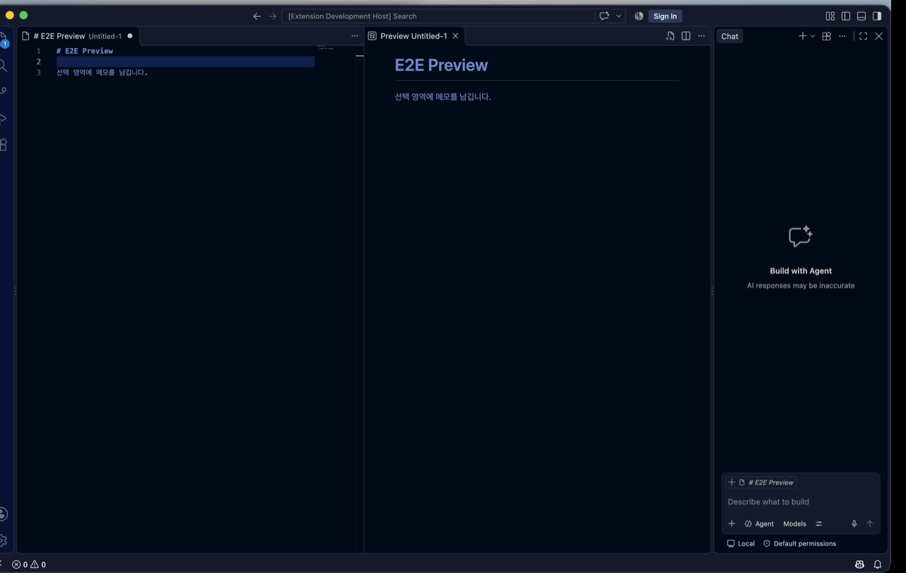

# Markdown Selection Notes

Markdown Selection Notes lets you add notes to selected text directly in the built-in Markdown Preview in VS Code.

Notes are linked to the selected text. When you reopen the document, the linked text is highlighted again, and clicking a note card takes you back to the original location.



## Requirements

- VS Code 1.85 or later

## Features

- Add notes by selecting text in the built-in Markdown Preview
- Show the selected text as a quotation
- Highlight text linked to saved notes
- Jump to the original text by clicking a note card
- Delete note cards
- Render large note lists progressively in batches of 40
- Collapse or expand the notes panel
- Resize the notes panel
- Store notes separately for each file
- Customize the highlight color
- Restore note positions after reopening the Preview or changing documents

## Usage

1. Open a Markdown file.
2. Open the built-in Markdown Preview.

   - macOS: `Cmd + Shift + V`
   - Command Palette: `Markdown Selection Notes: Open Preview`

3. Select the text you want to annotate in the Preview.
4. Click the `Add Note` button that appears above or below the selection.
5. Enter your note and click `Save`.
6. Review the saved note in the notes panel on the right.

Click a note card to jump to the linked text. To delete a note, click the `×` button on the right side of its card.

### Create the demo GIF

The demo command expands VS Code to fill the main display, slowly performs the real Preview UI flow, and creates `docs/demo.gif` from captures cropped to the VS Code window area.

```bash
npm run test:e2e:demo
```

This command is intended for macOS and requires Screen Recording and Accessibility permissions for the terminal or editor running the command. Close private windows and notifications before running it because the capture is taken from the main display before cropping.

## Configuration

Search for `Markdown Selection Notes` in VS Code Settings, or add the settings directly to `settings.json`.

```json
{
  "markdownSelectionNotes.previewColumn": "beside",
  "markdownSelectionNotes.highlightColor": "#ffd33d"
}
```

### `markdownSelectionNotes.previewColumn`

Controls where the Markdown Preview opens.

- `beside`: Open the Preview beside the active editor
- `active`: Open the Preview in the active editor area

The default value is `beside`.

### `markdownSelectionNotes.highlightColor`

Controls the highlight color for text linked to a note. HEX, `rgb()`, and `rgba()` values are supported.

```json
{
  "markdownSelectionNotes.highlightColor": "rgba(255, 211, 61, 0.75)"
}
```

## Data Storage

Notes are stored locally and are not sent to an external server.

- Notes are stored in IndexedDB, separated by file.
- Existing `localStorage` data is migrated automatically the first time the Preview is opened.
- `localStorage` is used as a fallback when IndexedDB is unavailable.
- File-specific identifiers prevent notes from different Markdown files from being mixed.

If the document text or structure changes and the saved location can no longer be identified reliably, the extension does not highlight an unrelated area.

## Troubleshooting

### The note button or notes panel does not appear

1. Close the built-in Markdown Preview.
2. Run `Developer: Reload Window` from the Command Palette.
3. Open the Markdown Preview again.

### The Preview does not open

Make sure the active file is a Markdown file, then run `Markdown Selection Notes: Open Preview` from the Command Palette.

## Development

```bash
npm install
npm run compile
```

Press `F5` to launch the Extension Development Host.

See [docs/RELEASING.md](docs/RELEASING.md) for the CI-first release process and Marketplace deployment setup.

## Testing

Run the unit tests and Preview DOM tests with:

```bash
npm test
npm run test:e2e:dom
```

To verify command registration in a real VS Code Extension Host:

```bash
npm run test:e2e:extension
```

To automatically test the actual built-in Markdown Preview UI—including mouse selection, the note button, text input, saving, note cards, and highlighting—run:

```bash
npm run test:e2e:ui
```

To keep VS Code open after the automated UI flow so you can inspect the result:

```bash
npm run test:e2e:ui:visible
```

Run the complete E2E suite with:

```bash
npm run test:e2e
```

The first Extension Host UI test automatically downloads a test VS Code runtime into `.vscode-test`.
